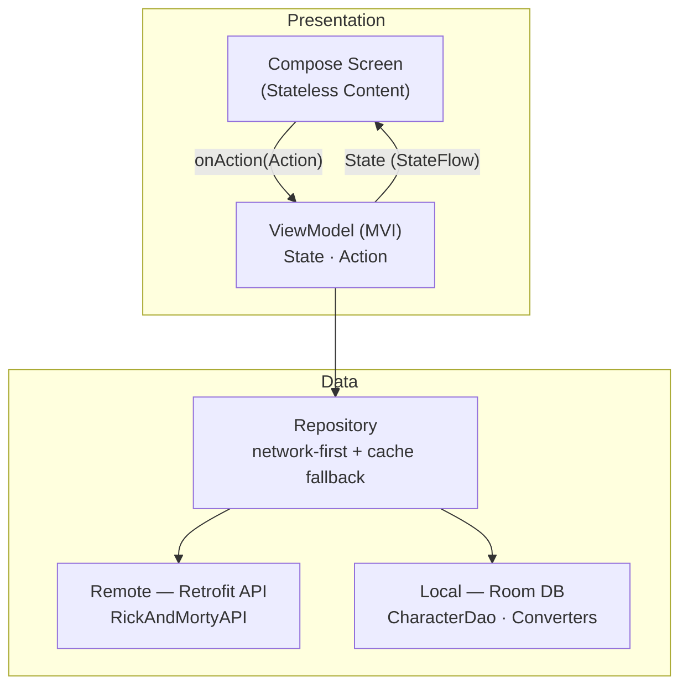
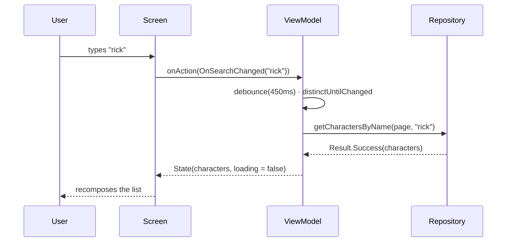

<div align="center">

# 🛸 Rick & Morty — Android

### Explore the multiverse — a modern Android showcase built with Jetpack Compose, Clean Architecture & MVI

[](https://kotlinlang.org)
[](https://developer.android.com/jetpack/compose)
[](https://m3.material.io)
[](https://developer.android.com/build)
[](https://developer.android.com)
[](#-architecture)
[](https://developer.android.com/training/data-storage/room)
[](https://coil-kt.github.io/coil/)
[](#-license)

A sleek Android client for [**The Rick and Morty API**](https://rickandmortyapi.com), featuring a
cinematic character list, shared-element navigation into a rich detail screen, offline caching,
and a handcrafted Rick & Morty–inspired design system in both light **and** dark mode.

</div>

---

## 📖 Table of Contents

- [✨ Features](#-features)
- [📸 Screenshots](#-screenshots)
- [🧰 Tech Stack](#-tech-stack)
- [🏗️ Architecture](#️-architecture)
- [🔄 Data Flow](#-data-flow)
- [📂 Project Structure](#-project-structure)
- [🎨 Design System](#-design-system)
- [🚀 Getting Started](#-getting-started)
- [🧪 Testing](#-testing)
- [🗺️ Roadmap](#️-roadmap)
- [📄 License](#-license)
- [👤 Author](#-author)

---

## ✨ Features

| | |
|---|---|
| 🎬 **Cinematic list** | Full-width 16:9 character cards with image scrims, status badges and press-scale feedback. |
| ♾️ **Infinite scroll** | Paged loading driven by `LazyListState`, guarded against duplicate requests. |
| 🔎 **Debounced search** | Live search across the multiverse with a 450 ms debounce and instant clear. |
| 🪄 **Shared-element morph** | The image and name smoothly morph from card → hero as you navigate to the detail screen. |
| 🧬 **Rich detail** | Status/species chips plus Profile, Origin, Location and Appearances (episode) sections. |
| 💀 **Graceful states** | Shimmer skeletons, an animated portal loader, and empty/error states with retry. |
| 💾 **Offline cache** | Room-backed cache with network-first strategy and transparent fallback. |
| 🌗 **Light & dark** | Full Rick & Morty palette for both themes, following the system setting. |
| 🏛️ **Clean + MVI** | Clear layer separation with a unidirectional `Action → State` flow. |
| 👁️ **Previewable** | Compose previews for **every** screen state in **both** light and dark. |

---

## 📸 Screenshots

> Add your captures to [`docs/screenshots/`](docs/screenshots) using the file names below — they'll render automatically.

| List · Light | List · Dark |
| :---: | :---: |
|  |  |

| Detail · Light | Detail · Dark |
| :---: | :---: |
|  |  |

---

## 🧰 Tech Stack

| Category | Technology | Version |
| :--- | :--- | :--- |
| **Language** | Kotlin | `2.3.20` |
| **UI** | Jetpack Compose · Material 3 | BOM `2026.03.01` |
| **Architecture** | Clean Architecture + MVI | — |
| **DI** | Hilt (Dagger) | `2.59.2` |
| **Async** | Kotlin Coroutines + Flow | — |
| **Networking** | Retrofit · OkHttp Logging | `3.0.0` · `5.3.2` |
| **Serialization** | Gson · kotlinx.serialization | `3.0.0` · `1.10.0` |
| **Persistence** | Room | `2.8.4` |
| **Images** | Coil 3 | `3.4.0` |
| **Navigation** | Navigation Compose (type-safe) | `2.9.0` |
| **Build** | AGP · Gradle · KSP | `9.0.1` · `9.1.0` · `2.3.12` |
| **SDK** | min / target / compile | `26` / `36` / `36` |
| **Toolchain** | JDK / JVM target | `21` / `11` |

---

## 🏗️ Architecture

The app follows **Clean Architecture** with an **MVI** presentation layer. Dependencies point inward:
the UI knows only about state and actions, the repository hides where data comes from, and the data
sources are swappable.



**MVI loop** — every user intent is an `Action`, transformed into an immutable `State`:



**Layers**

- **Presentation** — `list/` & `detail/` each expose a stateless `*Content` composable (previewable)
  plus a stateful screen, `State`, `Action` and a Hilt `ViewModel`.
- **Data** — `repository/` orchestrates `data_source/` (Retrofit + Room) and `mappers/` convert DTOs
  to Room entities. `util/` holds the `Result<T, Error>` sealed types.
- **DI** — `di/RickAndMortyModule.kt` provides the API, database and repository singletons.

---

## 🔄 Data Flow

1. The user types in the search field → `OnSearchChanged` updates state.
2. The ViewModel debounces the query, then calls `Repository.getCharactersByName(page, name)`.
3. The repository hits the **network first**; on failure it **falls back to Room** cache.
4. Network results are **upserted** into Room and emitted back as `State`.
5. The list recomposes; scrolling near the end emits `OnNextPageRequested` for the next page.

---

## 📂 Project Structure

<details>
<summary><b>Expand the module tree</b></summary>

```text
app/src
├── debug/java/…/presentation/preview/ScreenPreviews.kt   # Light & dark previews for all states
└── main/java/com/mohammed/rickandmorty
    ├── MainActivity.kt                                   # SharedTransitionLayout + NavHost
    ├── RickAndMortyApp.kt                                # @HiltAndroidApp
    ├── ui/theme/                                         # Color · Shape · Theme · Type
    └── fueature/rick_and_morty
        ├── data
        │   ├── data_source
        │   │   ├── local/db                              # RoomDatabase · Converters
        │   │   │   ├── dao/CharacterDao.kt
        │   │   │   ├── entity/Character.kt
        │   │   │   ├── Converters.kt
        │   │   │   └── RickAndMortyDB.kt
        │   │   └── remote/rick_and_morty_api             # Retrofit service + DTOs
        │   │       ├── RickAndMortyAPI.kt
        │   │       └── dto/ (Character, CharactersDto, Info, Location, Origin)
        │   ├── mappers/RickAndMortyMappers.kt
        │   ├── repository/RickAndMortyRepository.kt
        │   └── util/ (Error.kt, Result.kt)
        ├── di/RickAndMortyModule.kt
        └── presentation
            ├── components/                               # CharacterCard, Chips, LoadingPortal, …
            ├── detail/                                   # Character detail (Screen · State · Action · VM)
            ├── list/                                     # Character list (Screen · State · Action · VM)
            └── navigation/                               # Type-safe Routes + NavHost
```

</details>

---

## 🎨 Design System

A Rick & Morty–inspired palette that adapts to light and dark.

| Swatch | Token | Hex | Usage |
| :---: | :--- | :--- | :--- |
|  | `RamBackground` | `#272B33` | App background (dark) |
|  | `RamSurface` | `#3C3E44` | Cards & sheets |
|  | `RamSurfaceElevated` | `#45484E` | Chips & elevated surfaces |
|  | `PortalBlue` | `#00B5CC` | Primary accent |
|  | `PortalGreen` | `#97CE4C` | Secondary accent |
|  | `PortalGlow` | `#B2DF28` | Tertiary glow |
|  | `StatusAlive` | `#55CC44` | Alive characters |
|  | `StatusDead` | `#D63D2E` | Dead characters |

Bold, tight typography (`displaySmall`, `headlineSmall`, …) and rounded, expressive shapes are defined
in `ui/theme/Type.kt` and `ui/theme/Shape.kt`.

---

## 🚀 Getting Started

**Prerequisites**

- Android Studio (latest stable) with **JDK 21**
- Android SDK with **API 36** platform & build-tools
- An internet connection (the app talks to `rickandmortyapi.com`)

**Clone & run**

```bash
git clone https://github.com/mohammed-amin20/Rick-And-Morty.git
cd Rick-And-Morty
```

Open the project in Android Studio and hit **Run ▶**, or from the CLI:

```bash
# Build a debug APK
./gradlew :app:assembleDebug

# Build & install on a connected device/emulator
./gradlew :app:installDebug
```

> The debug APK is written to `app/build/outputs/apk/debug/`.

---

## 🧪 Testing

```bash
# Unit tests
./gradlew test

# Instrumented tests (requires a device/emulator)
./gradlew connectedAndroidTest
```

Compose previews live in `app/src/debug/…/presentation/preview/ScreenPreviews.kt` and cover the list
and detail screens in **loading, content, empty, pagination and error** states — in **both** light and
dark mode.

---

## 🗺️ Roadmap

- [ ] Paging 3 integration for the character list
- [ ] Offline-first single source of truth (Flow from Room)
- [ ] Search filters (status, species, gender)
- [ ] Episodes & locations browsing tabs
- [ ] UI snapshot tests for the preview states
- [ ] Downloadable Rick & Morty font

---

## 📄 License

Released under the **MIT License**. See [LICENSE](LICENSE) for details.

```
MIT License · Copyright (c) 2026 mohammed-amin20
```

---

## 👤 Author

<div align="center">

**Mohammed Amin** — [@mohammed-amin20](https://github.com/mohammed-amin20)

Made with 🛸 & ☕ — powered by [The Rick and Morty API](https://rickandmortyapi.com)

</div>
